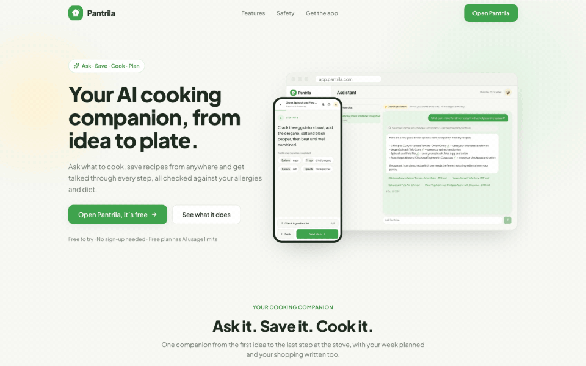
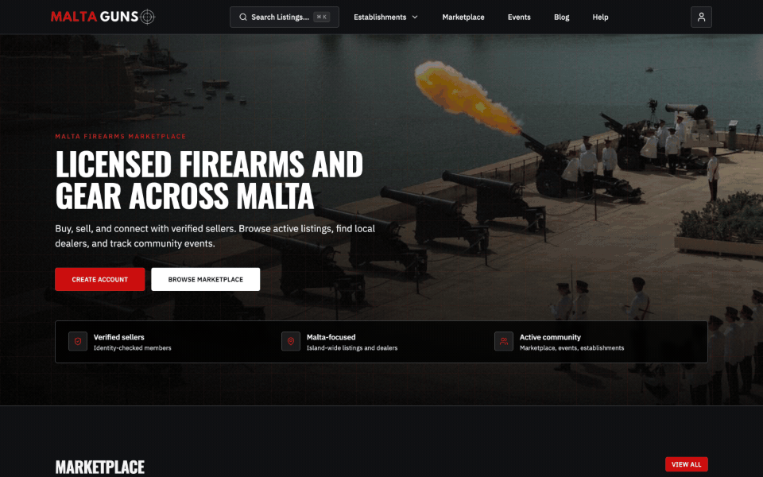
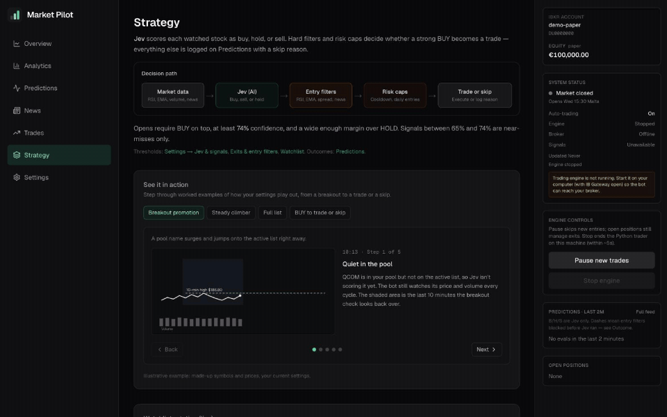
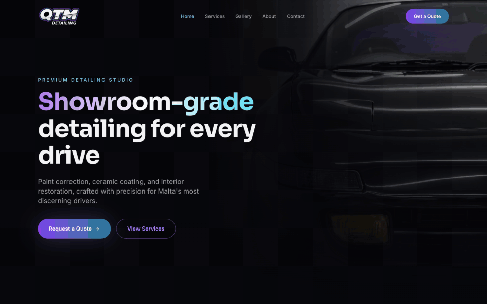

<h1 align="center">Michael Gauci</h1>

  

  📍 Based in Malta 
  <a href="mailto:mikegauci@gmail.com">Email</a> · <a href="https://www.linkedin.com/in/michael-gauci-422180104">LinkedIn</a>

  
  
  
  

I'm a full-stack developer working across TypeScript and Python. On the front end I build React and Next.js interfaces, analytics dashboards and admin tools. On the back end I write the APIs, Supabase data models and Python services behind them, such as a FastAPI meal-planning backend and a trading engine connected to Interactive Brokers.

I integrate LLMs into products, not just chat boxes. That includes retrieval-augmented generation over a recipe catalogue, structured buy, hold or sell decisions gated by hard risk filters, and evaluation suites that check model output before it ships.

I also migrate sites between frameworks: WordPress to Next.js or Astro and Gatsby to Astro. The Next.js moves run on Vercel and Supabase, with page-by-page parity checks, managed redirects, a custom SEO layer and custom CMS tools so editors can manage content themselves.

<b>More about me</b>

 

- **What I'm building now:** Onyx, which is two products in one monorepo. Onyx Studio is a public website, and Onyx Platform is a multi-tenant SaaS for business operations and AI automation. Both have Next.js front ends sharing shadcn/ui components, on top of a FastAPI backend and Postgres.
- **Client work:** mostly for businesses in Malta. I move e-commerce and content sites off WordPress onto Next.js and Supabase, with Stripe payments, transactional email and admin panels the owners run themselves. One was a bilingual English and Arabic site with full right-to-left layouts.
- **Design as well as code:** I go from Figma layouts and Photoshop and Illustrator assets to the design systems the components are built on, so a project doesn't need a separate hand-off.
- **What I care about:** the unglamorous parts that keep a product healthy, such as typed APIs, migrations committed to the repo, error tracking with Sentry and agents that follow the same rules as the rest of the team.
- **Away from the keyboard:** I follow Formula 1, and Daft Punk is usually playing while I code.

## Tech stack

  

Also: OpenAI API · pgvector · Expo · PixiJS · Recharts · shadcn/ui · Interactive Brokers API

## Projects

### 🎰 iGaming Canvas Lab

`TypeScript` `PixiJS` `Vite` `Vitest` `pnpm workspaces`

Five playable browser games built with PixiJS and TypeScript. I separated game logic from rendering so outcomes can be tested independently. Mini Slot animates the reels toward a predetermined result, and Crash uses a mock server clock to determine whether a cash-out arrives in time.

**[Casino Floor](https://igaming-canvas-lab.vercel.app/)** · **[Browse Codebase](https://github.com/mikegauci/igaming-canvas-lab)**

<b>More details</b>

 

- **Five games behind one arcade landing page:** Mini Slot (masked reel strips, slam-stop, exact RTP enumeration), Lucky Wheel (weighted outcomes, velocity-matched easing), Scratch Card (RenderTexture brush with a coverage grid), Crash (real-time curve, server-timed cash-out race) and Bonus Round (rigged mascot, BIG/MEGA/EPIC win roll-ups).
- **Server decides, client animates:** a mock outcome server settles every round before anything moves, so the client only plays towards a result it was handed, the way a real game server works.
- **Shared engine:** `@lab/core` holds a seeded RNG, wallet, round state machine, scene manager and HUD components. Its Pixi-free logic layer is what the Vitest suite imports, so the game maths is tested without a renderer.
- **Built like production:** strict TypeScript, one Vite app per game assembled into a single Vercel deploy, GitHub Actions CI, and every game works in portrait and landscape.

### 🥗 Pantrila

`Next.js` `Expo` `TypeScript` `Python` `FastAPI` `LangGraph` `OpenAI` `pgvector` `Supabase`

A meal planner with Next.js and Expo clients, a shared TypeScript API client, and a Python backend with retrieval-augmented generation and LLM evaluations.

**[Public Site](https://pantrila.com/)** · **[Public App (Try it as Guest)](https://app.pantrila.com/)**

<b>More details</b>

 

- **Ask, save, cook, plan:** ask what to cook and get answers from a 300-recipe corpus and your pantry, save recipes from TikTok, Instagram, Facebook, links, photos or text, cook step by step hands-free, then plan the week.
- **The model proposes, code decides:** a LangGraph agent plans the week around your diet, allergies and nutrition targets, but every recipe and plan is re-checked by deterministic code before you see it. A plan that still breaks a hard rule after two repairs gets the meal swapped by code, or the planner refuses.
- **Hybrid search:** vector and full-text retrieval combined reach recall@10 of 0.843 and MRR of 0.922 on 65 labelled queries, beating either retriever alone.
- **Evals with committed reports:** recipe search, the meal planner, the cooking assistant and recipe import each have an eval set. For example, the planner has zero hard violations across 16 diet and allergy profiles, and the eval gate fails on any violation.
- **Nutrition from real data:** values are calculated from ingredient weights using USDA FoodData Central and the French Ciqual table.
- **Everywhere:** a Next.js web app and an Expo app for iPhone and Android share one TypeScript API client. Guests can try it without an account and add Google sign-in later without losing anything.

### 🎯 MaltaGuns

`Next.js` `React` `TypeScript` `Supabase` `Tailwind CSS` `Radix UI` `TanStack Table` `Tiptap` `Resend`

I built the platform end to end in Next.js and TypeScript, from the public marketplace to a custom CMS and admin CRM for managing listings, articles, events, and users.

**[Public Site](https://www.maltaguns.com/)** · **[Browse Codebase](https://github.com/mikegauci/maltaguns-app)**

Admin screens show sample data.

<b>More details</b>

 

- **Marketplace:** firearms and non-firearms listings with categories, wishlists, featured placements and expiry dates, plus a directory of local establishments and a community events calendar.
- **Verified sellers:** identity checks run through Didit, with results arriving by webhook into an admin review queue. Uploaded firearm licences are checked with Tesseract OCR, which auto-rotates the image before reading it.
- **Payments:** listing credits, event credits and featured placements are sold through a hosted checkout, confirmed by webhook and recorded in the admin's payments view.
- **Admin CRM and CMS:** users, identity reviews, listing moderation, reported listings, establishments, events, a Tiptap blog editor, legal pages, per-page SEO and notifications, all built on TanStack Table and Radix UI.
- **Housekeeping:** scheduled jobs send notifications, Resend handles transactional email, and the site generates its own sitemap and robots rules.

### 📈 Market Pilot

`Next.js` `TypeScript` `Recharts` `Python` `OpenAI` `Supabase` `Interactive Brokers API`

A Next.js trading analytics dashboard with Recharts for equity and daily profit and loss, candlestick charts, and a Python trading engine connected to Interactive Brokers. An LLM scores each watched stock as buy, hold or sell, and hard entry filters and risk caps decide whether a strong BUY becomes a trade. The strategy page walks through that path step by step.

**[Browse Codebase](https://github.com/mikegauci/market-pilot)**

<b>More details</b>

 

- **Decision path:** market data (RSI, EMA, volume, news) goes to Jev, the LLM, which returns buy, hold or sell with a confidence score. Entry filters and risk caps then decide whether to trade, and every skip is logged with its reason.
- **Hard rules around the model:** a BUY needs at least 74% confidence and a clear margin over HOLD. Cooldowns and daily entry limits cap exposure, and the RSI ceiling only loosens inside a 10-minute breakout window.
- **Watchlist rotation:** the active list holds 12 names. A stock that breaks out of its 10-minute high on rising volume is promoted onto the list and protected for the length of its breakout window.
- **Architecture:** only the Python engine talks to Interactive Brokers. It writes to Supabase, and the Next.js dashboard on Vercel reads from it, with pause and stop controls and a read-only role for viewers.
- **Dashboard:** equity and daily profit-and-loss charts with Recharts, candlestick charts, a predictions feed and a settings page for the strategy thresholds. It runs against an IBKR paper account.

### 🚗 QTM Detailing

`Next.js` `TypeScript` `Supabase` `Tailwind CSS` `shadcn/ui` `Google APIs` `OpenAI` `FullCalendar` `dnd kit`

A Next.js site with Tailwind and shadcn/ui, a custom CMS and CRM for bookings and leads, and a Google Drive integration for importing gallery photos.

**[Public Site](https://qtmdetailing.mt/)** · **[Browse Codebase](https://github.com/mikegauci/qtm-detailing)**

Admin screens show sample data.

<b>More details</b>

 

- **Marketing site:** a dark, animated Next.js 16 site with services, pricing, a before-and-after gallery and an about page. Every quote button opens the same WhatsApp link.
- **CRM:** leads, customers, bookings, a drag-and-drop Kanban board built with dnd kit, a FullCalendar view and inventory with low-stock tracking.
- **Google integrations:** bookings sync to Google Calendar, and gallery photos are imported straight from a Google Drive folder.
- **AI photo enhancement:** imported gallery photos can be cleaned up with OpenAI's image model before they're published.
- **CMS:** site settings, services, pricing, FAQ, testimonials and page copy are all editable from the admin, backed by Supabase.

## How I use coding agents

I work with **Claude Code**, **Codex** and **Cursor** every day, and I set each repository up so all three follow the same rules. `CLAUDE.md` and `AGENTS.md` hold the project instructions, and Cursor rules and skills cover the conventions that are easy to get wrong. In MaltaGuns, skills describe the design system and the firearms domain. In QTM Detailing, a rule keeps every quote button pointing at the same WhatsApp link.

<b>Skills, MCP servers and how I test LLM features</b>

 

I turn recurring work into skills, so it runs the same way every time. Market Pilot has skills for preflight checks, adding a strategy filter, diagnosing the trader and reviewing a trading session. The preflight skill picks which tests, lint checks and builds to run based on what changed. In Pantrila, the mobile agent guide calls for checking the installed Expo version against its documentation before writing code. [Preflight skill](https://github.com/mikegauci/market-pilot/blob/main/.agents/skills/preflight-checks/SKILL.md) · [Mobile agent guide](https://github.com/mikegauci/pantrila/blob/main/mobile/AGENTS.md)

I connect agents to the services the apps run on through MCP servers. In Market Pilot, schema changes go through the Supabase MCP server and are saved as migration files in the same step, so the database and the repository stay in sync.

On the product side, I treat LLM features like any other code that has to be tested. Model calls return structured output against a JSON schema instead of free text, Pantrila's retrieval runs on OpenAI embeddings stored in pgvector, and its eval suites score retrieval, chat and meal-plan quality and save reports, so a prompt or model change that makes results worse shows up before it ships.

