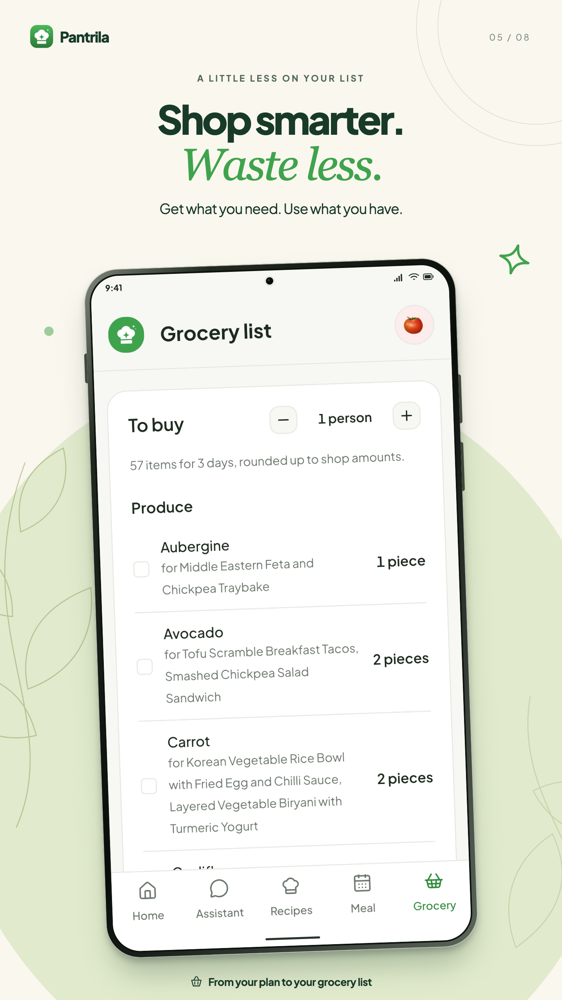

# Michael Gauci

I'm a full-stack developer. I build React and TypeScript interfaces, analytics dashboards, and the APIs and admin tools behind them. I've also migrated WordPress sites to Next.js and built custom CMS tools so editors can manage content themselves.

## Featured project · iGaming Canvas Lab

Five playable browser games built with PixiJS and TypeScript. I separated game logic from rendering so outcomes can be tested independently. Mini Slot animates the reels toward a predetermined result, and Crash uses a mock server clock to determine whether a cash-out arrives in time.

[Play Mini Slot](https://igaming-canvas-lab.vercel.app/slot/) · [Play Crash](https://igaming-canvas-lab.vercel.app/crash/) · [Browse the code and tests](https://github.com/mikegauci/igaming-canvas-lab/tree/main/apps)

## Selected work

- **Market Pilot** · A Next.js trading analytics dashboard with Recharts for equity and daily profit and loss, candlestick charts, and a Python integration with Interactive Brokers. The strategy page walks through how a breakout moves from a signal to a trade or a skip. [Strategy page](https://market-pilot-dashboard.vercel.app/strategy) · [Dashboard code](https://github.com/mikegauci/market-pilot/blob/main/dashboard/components/analytics-dashboard.tsx)

- **MaltaGuns** · I built the platform end to end in Next.js and TypeScript, from the public marketplace to a custom CMS and admin CRM for managing listings, articles, events, and users. [Public site](https://www.maltaguns.com/) · [Frontend code](https://github.com/mikegauci/maltaguns-app/blob/main/app/page.tsx) · [Admin dashboard code](https://github.com/mikegauci/maltaguns-app/blob/main/app/admin/page.tsx)

- **QTM Detailing** · A Next.js site with Tailwind and shadcn/ui, a custom CMS and CRM for bookings and leads, and a Google Drive integration for importing gallery photos. [Public site](https://www.qtmdetailing.mt/) · [Repository](https://github.com/mikegauci/qtm-detailing)

Admin screens show sample data.

- **Pantrila** · A meal planner with Next.js and Expo clients, a shared TypeScript API client, and a Python backend with retrieval-augmented generation and LLM evaluations. [Repository](https://github.com/mikegauci/pantrila) · [Try the guest demo](https://app.pantrila.com)

<a href="https://github.com/mikegauci/pantrila">
  &nbsp;
  
</a>

## How I use coding agents

I write project-specific instructions and reusable skills for recurring work. In Market Pilot, a preflight skill specifies which tests, lint checks, and builds to run based on what changed. In Pantrila, the mobile agent guide calls for checking the installed Expo version against its documentation and running lint and type checks. [Preflight skill](https://github.com/mikegauci/market-pilot/blob/main/.agents/skills/preflight-checks/SKILL.md) · [Mobile agent guide](https://github.com/mikegauci/pantrila/blob/main/mobile/AGENTS.md)
